# Госархив ВКО — новый сайт

[](https://github.com/megaknight707/gosarchiv-vko-hackathon/actions/workflows/ci.yml)

Переосмысленный сайт Государственного архива Восточно-Казахстанской области: электронный каталог с поиском «своими словами», онлайн-выставки, «Архив памяти», карта филиалов с маршрутами, ИИ-помощник и админка с согласованием публикаций — на казахском, русском и английском.

**Демо:** https://gosarchiv-vko-hackathon.vercel.app · **Действующий сайт архива:** http://e-arhiv.vko.gov.kz/ru

> Сайт **информационный**: без заявлений, заказов и оплаты. Сведения о государственной и платных услугах — только справочно, со ссылками на eGov / e-vko. Единственная форма — «Отзывы и предложения».
> Это проект Code Masters Hackathon 9.0, **не официальный сайт** архива. Записи каталога — демонстрационные (помечены «Демо»); контакты, филиалы, история, перечень фондов, календарь дат и прейскурант — реальные данные архива.

| Главная | Тёмная тема, EN |
|---|---|
| 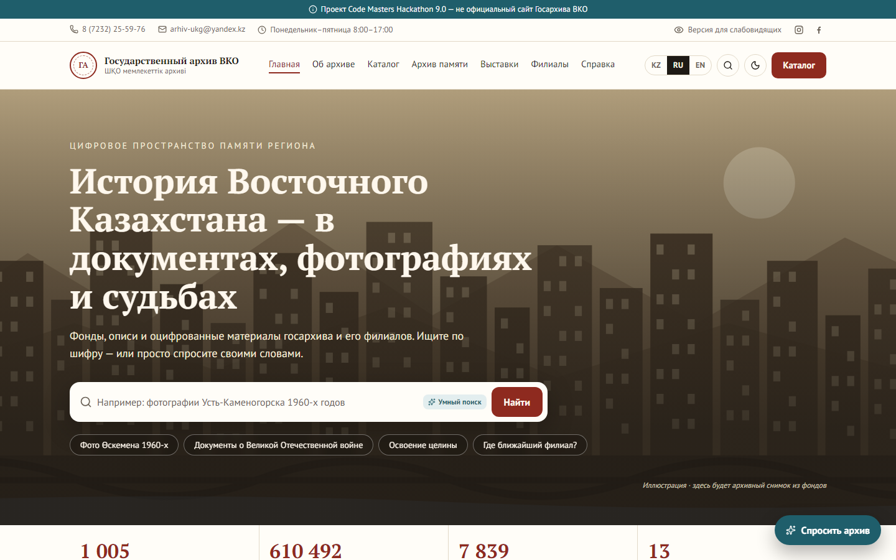 | 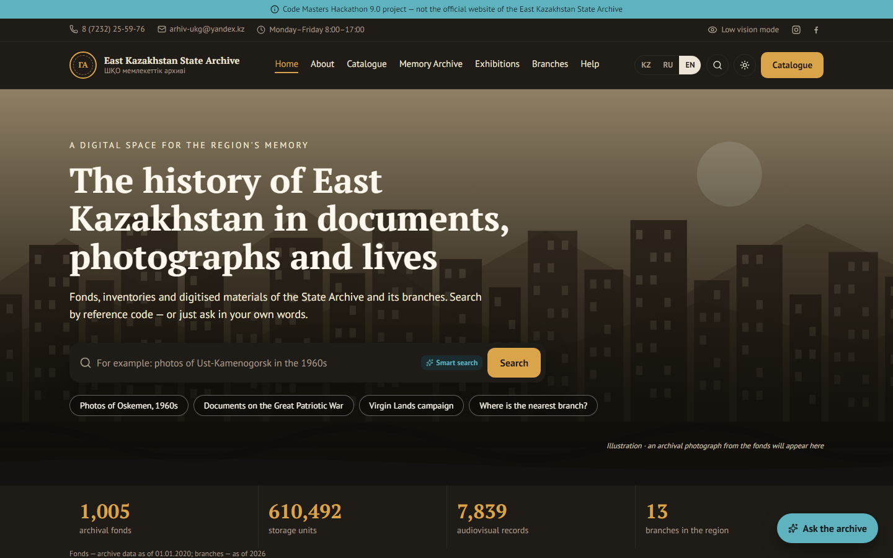 |
| **Каталог: «фотографии Усть-Каменогорска 1960-х»** | **Карточка документа со сканом** |
| 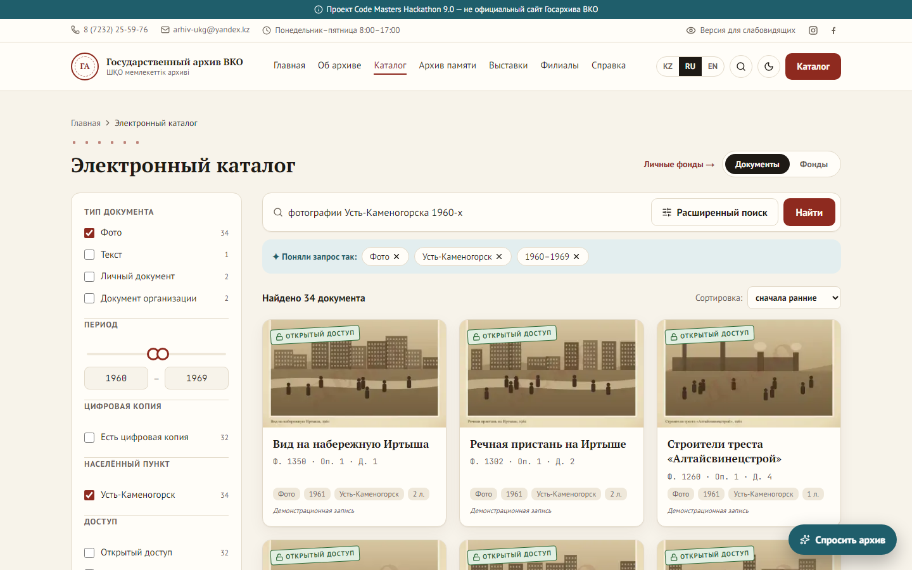 | 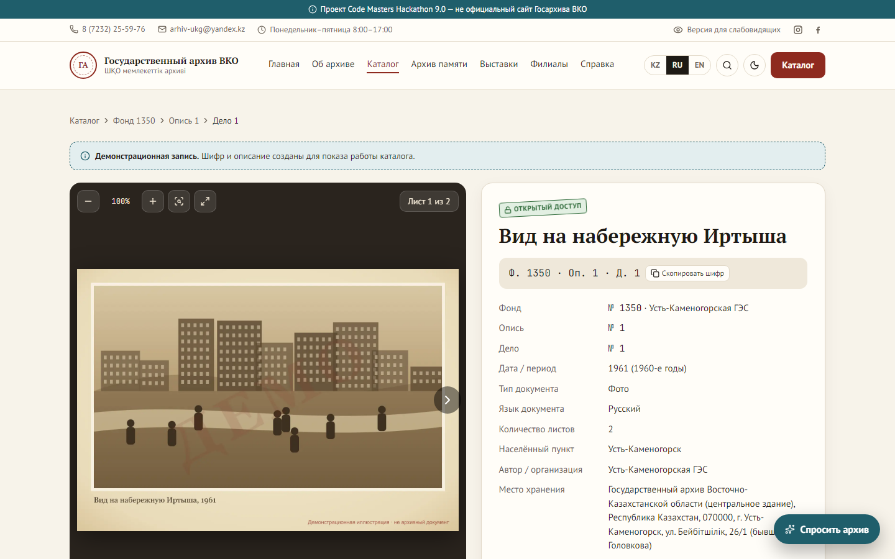 |
| **Онлайн-выставка** | **Филиалы и маршрут** |
| 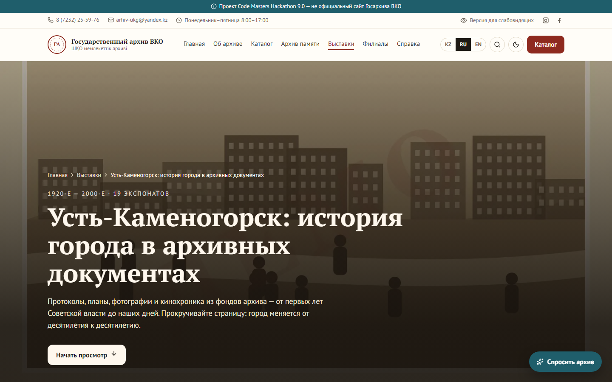 | 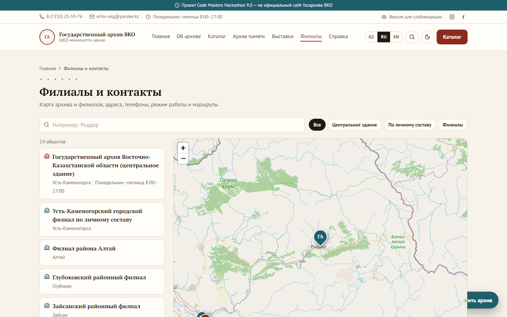 |
| **Админка: документы** | **Админка: аналитика и рекомендации ИИ** |
| 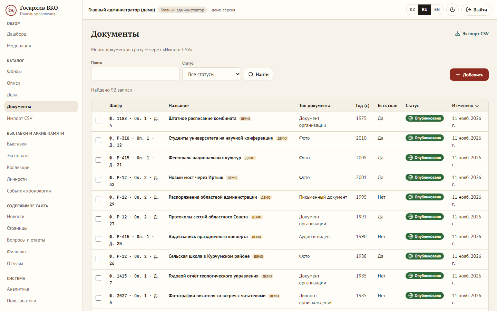 | 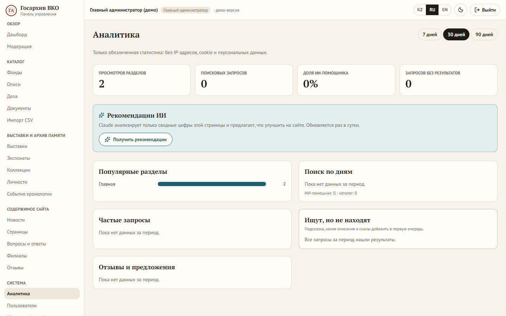 |

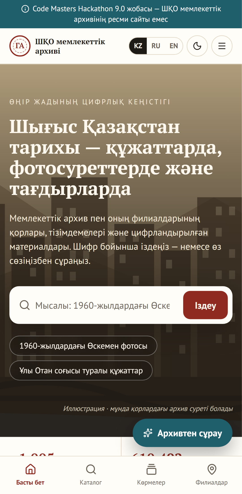

## Было → стало

| Было на действующем сайте | Стало |
|---|---|
| Два языка (Қаз / Рус) | KZ / RU / EN на всех страницах и в админке |
| Фонды — файлы `.xlsb` для скачивания | Каталог с поиском, фильтрами и карточкой документа; перечень 1 667 фондов с поиском |
| Филиалы переключают весь сайт | Одна карта 13 филиалов с адресами и маршрутами 2GIS / Google Maps |
| HTTPS перенаправляет на HTTP | Только HTTPS, заголовки безопасности |
| Опрос, погода, счётчики в колонках | Главная начинается с поиска «спросите своими словами» |
| Прейскурант — скан на 15 страниц | Прейскурант из «Әділет» с поиском по 218 позициям |
| Поиск — одна строка | Поиск по шифру, году, месту, типу + ИИ-помощник |
| Нет тёмной темы и мобильной версии | Тёмная тема, мобильная версия с нижним меню, режим для слабовидящих |
| Случайные обои в слайдере | Только архивные материалы с подписью источника, демо — с пометкой |

Подробно — [docs/current-site-audit.md](docs/current-site-audit.md).

## Возможности

- **Каталог** — Фонд → Опись → Дело → Документ; поиск своими словами («фото Өскемен 60-х», опечатки, «Лениногорск» → Риддер), по шифру `Ф. 1520 · Оп. 2 · Д. 14`, 10 фильтров в адресе страницы (ссылкой можно поделиться), просмотр сканов с увеличением, копирование шифра, избранное без регистрации, связанные материалы.
- **Онлайн-выставки** — история с прокруткой, лайтбокс, источник у каждого экспоната.
- **Архив памяти** — 11 направлений, коллекции, хронология, личности, календарь памятных дат (196 дат 2022–2026).
- **Филиалы** — карта Leaflet/OpenStreetMap, маршрут от геолокации или от введённого адреса.
- **Услуги (справочно)** — государственная услуга (способы обращения, отчёт за 2025 год), прейскурант № 289, законодательство, читальный зал.
- **ИИ-помощник** — Claude с инструментами поиска по каталогу, филиалам, разделам и FAQ; отвечает на языке посетителя, только по данным сайта, со ссылками на карточки; не принимает заявления; без интернета/ключа работает упрощённый режим.
- **Админка** — 7 ролей, универсальный CRUD 13 разделов, загрузка сканов, согласование публикаций, журнал действий, импорт/экспорт CSV, аналитика «что ищут и не находят», рекомендации ИИ.

## Архитектура

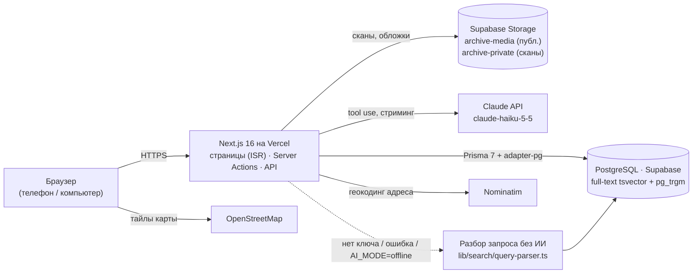

Один Next.js-проект, без отдельного бэкенда, Elasticsearch и Redis. Публичные страницы собираются заранее и обновляются раз в час и сразу после публикации из админки.

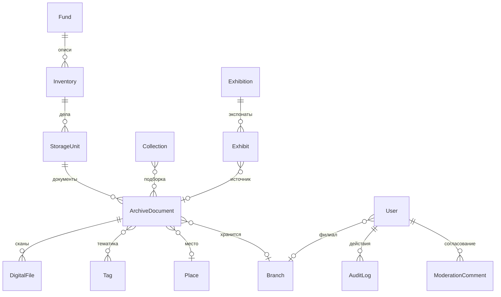

Также: `News`, `Page`, `FaqItem`, `Feedback`, `SearchLog`, `PageView`, `AiCache`, `RateLimit`, `MemorableDate`, `FundRegistryEntry`, `HistoricalPerson`, `HistoricalEvent`. Многоязычные поля — суффиксы `Kz / Ru / En`.

| Задача | Решение |
|---|---|
| Фреймворк | Next.js 16 (App Router, TypeScript), next-intl, next-themes |
| База | PostgreSQL (Docker локально, Supabase в проде), Prisma 7 |
| Поиск | full-text `tsvector` (триггер) + `pg_trgm` + словарь мест с прежними названиями |
| Стили | Tailwind CSS 4 + shadcn/ui, дизайн-система «Бумага и чернила» |
| Карта | Leaflet + OpenStreetMap |
| ИИ | `@anthropic-ai/sdk`: tool use, стриминг, кэш промпта и ответов, лимит запросов |
| Проверки | Vitest (55 unit-тестов), Playwright (11 E2E), GitHub Actions |

## Соответствие ТЗ

Полная таблица — [docs/tz-coverage.md](docs/tz-coverage.md).

| | ✅ сделано | 🟡 частично | 🗺 дорожная карта |
|---|---|---|---|
| Основное ТЗ | 76 | 6 | 3 |
| Дополнения к ТЗ (10.11.2026) | 30 | 1 | 4 |

## Безопасность (ТЗ §7.3)

| Требование | Как сделано |
|---|---|
| HTTPS | Vercel, HSTS; CSP с `upgrade-insecure-requests` |
| Пароли | bcrypt (cost 12), временный пароль показывается один раз |
| Сессии | подписанная httpOnly-cookie (JWT, `jose`), `secure`, `sameSite=lax`; автовыход через 30 минут бездействия |
| Перебор паролей | блокировка после 5 неудачных попыток на 15 минут; одинаковый ответ для «нет пользователя» и «неверный пароль» |
| Права | матрица `lib/auth/permissions.ts`, проверка на сервере в каждой странице и Server Action; администратор филиала — только свой филиал |
| SQL-инъекции | Prisma и параметризованный `$queryRaw` |
| XSS | экранирование React, ответ ИИ — свой безопасный рендерер без HTML, CSP |
| CSRF | Server Actions (проверка Origin в Next.js), проверка Origin в API |
| Загрузка файлов | тип по сигнатуре + MIME + размер ≤ 20 МБ (PDF/JPG/PNG/WebP/TIFF), SHA-256 мастер-файла |
| Закрытые материалы | сканы в приватном хранилище, `/api/files/{id}` отдаёт посетителю только опубликованные открытые документы (иначе 403); `noindex` для закрытых карточек |
| Журнал | `AuditLog`: входы, изменения (поля «было → стало»), статусы, файлы, импорт, пользователи; без паролей |
| Заголовки | CSP, X-Frame-Options DENY, nosniff, Referrer-Policy, Permissions-Policy (`geolocation=(self)`) |
| Секреты | только переменные окружения сервера; `.env*` в `.gitignore`; история проверена на ключи |
| Персональные данные | поиск и аналитика без IP; лимиты — по солёному хэшу IP |

## Запуск локально

Нужны Node.js 24 и Docker Desktop.

```bash
npm install
```

```bash
npm run db:up
```

```bash
npm run db:migrate
```

```bash
npm run seed
```

```bash
npm run dev
```

Сайт — http://localhost:3000, админка — http://localhost:3000/ru/admin. Пароли демо-сотрудников сид печатает в консоль (или `npm run staff:password -- --all`). Для ИИ-помощника нужен ключ: скопируйте `.env.example` в `.env.local` и заполните `ANTHROPIC_API_KEY`; без ключа работает упрощённый режим.

| Команда | Что делает |
|---|---|
| `npm run seed:reset` | Вернуть демо-данные в исходное состояние |
| `npm run seed:restricted` | Демо закрытого скана (негативный сценарий) |
| `npm test` / `npm run test:e2e` | Unit-тесты / E2E-сценарии Playwright |
| `npm run typecheck` / `lint` / `build` | Проверки и сборка |
| `npm run prod:migrate` / `prod:seed…` | То же для продакшена (Supabase), ключи из `.env.production.local` |

**Деплой:** push в `main` → GitHub Actions (линтер, типы, тесты, миграции, сборка) → Vercel. Миграции на прод — `npm run prod:migrate` до пуша кода, который их использует.

## Демо-доступ к админке

Публично доступа нет. Учётные записи всех семи ролей **выдаются жюри на защите**.

## Документация

- [Покрытие ТЗ](docs/tz-coverage.md) и [дополнений к ТЗ](docs/tz-additions.md)
- [Комплект передачи: инструкция редактора, интеграции, тестовые данные, готовность модулей](docs/handover.md)
- [Lighthouse](docs/lighthouse.md) · [Дорожная карта](docs/roadmap.md) · [Реальные данные архива](docs/real-archive-data.md)
- Защита: [сценарий демонстрации](docs/defense/demo-script.md) · [вопросы жюри](docs/defense/qa-prep.md) · [слайды](docs/defense/slides-outline.md)

## Дорожная карта (кратко)

Загрузка больших сканов напрямую в хранилище · OCR и подсказки полей карточки от ИИ · импорт XLSX с сопоставлением полей · версии материалов с откатом · перенос реальных описей и дел · английский перевод календаря и прейскуранта · опрос посетителей после согласования с архивом. Полностью — [docs/roadmap.md](docs/roadmap.md).

---

Code Masters Hackathon 9.0 · соло-проект ([megaknight707](https://github.com/megaknight707)) · защита 13 ноября 2026
